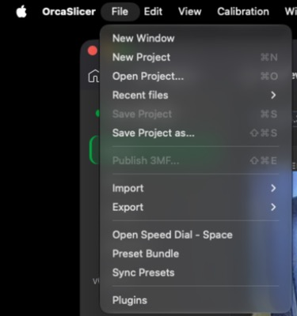
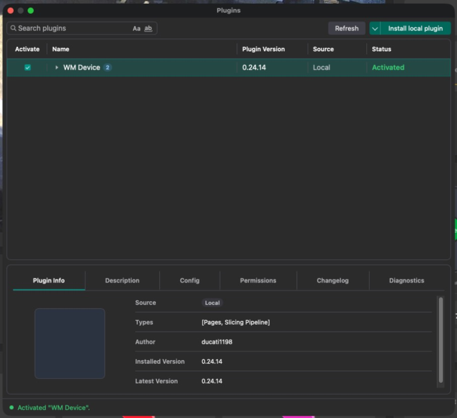
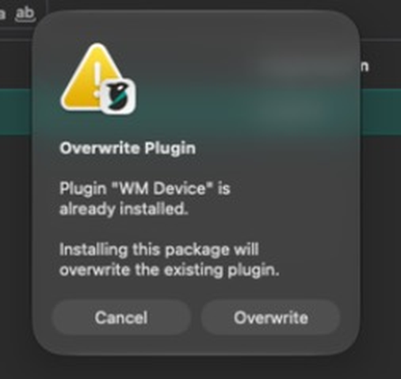
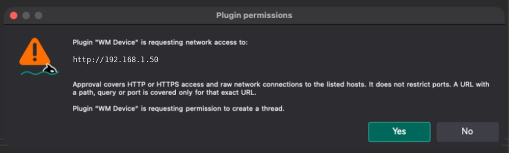
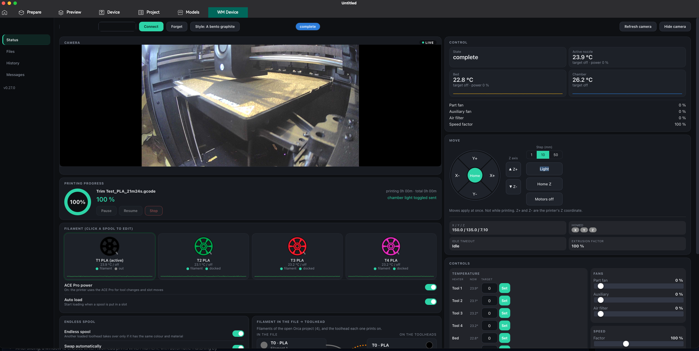
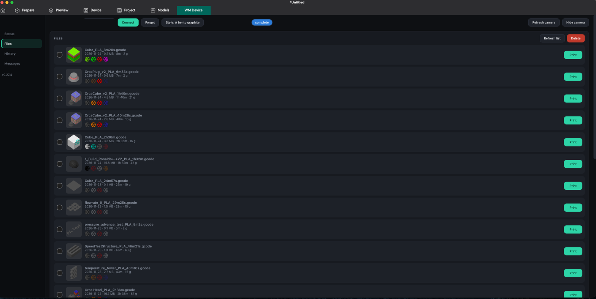
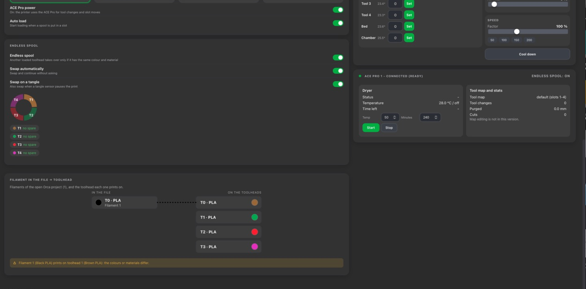
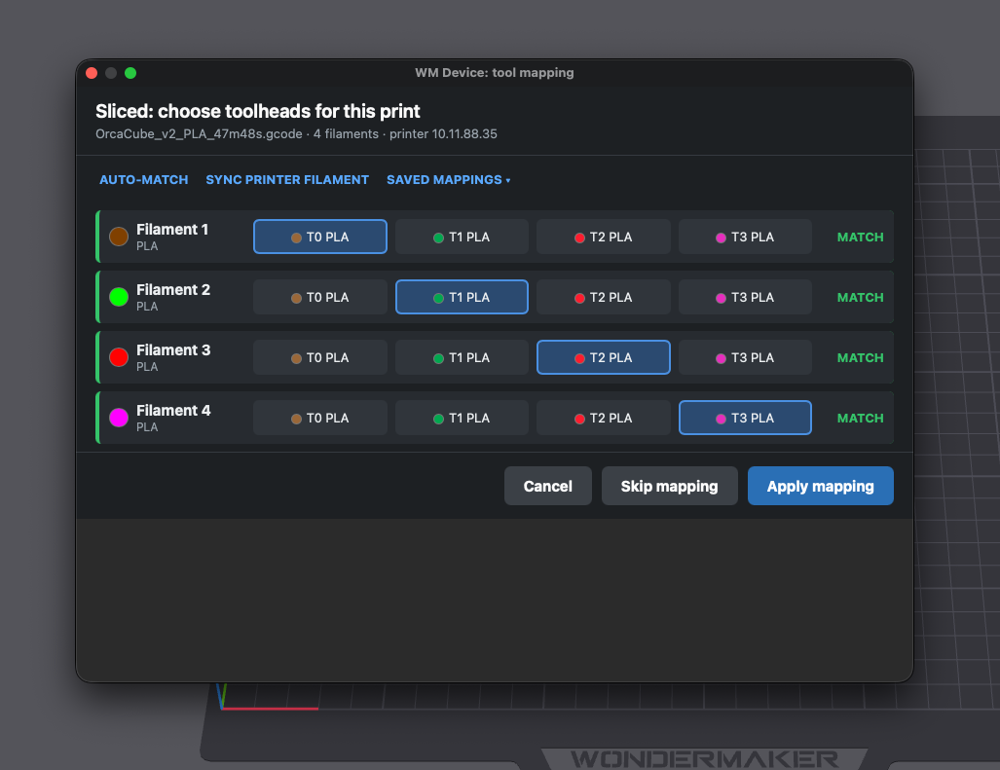
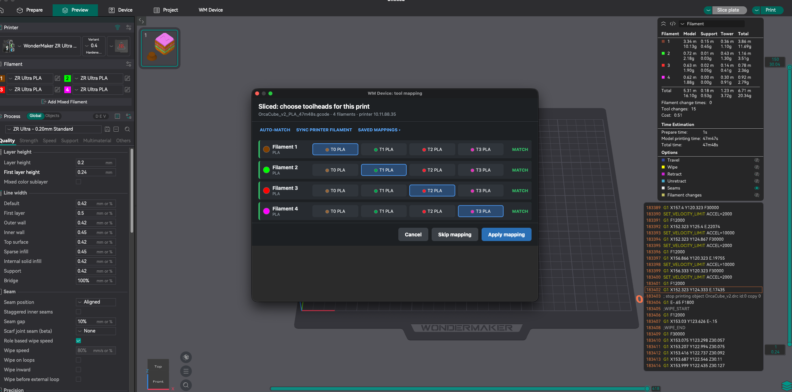

<div align="center">

# WM Device: OrcaSlicer plugin for WonderMaker ZR Ultra / Ultra-S

**A Device tab and a tool mapping step for OrcaSlicer 2.5.2: watch and control your WonderMaker (Moonraker) printer, and choose which toolhead prints which filament of the file.**

**Works with the factory Klipper and the factory app: you do not need to change anything on your printer.** The plugin only talks to the printer's Moonraker, so it runs next to the factory Klipper and the factory screen app as they are. Nothing is installed on the printer. (Connecting and live status are checked on a factory printer; a full multi-colour print on factory firmware is still being tested.)

**Related projects:** [WM_Ultra_Vanilla_Klipper](https://github.com/ducati1198/WM_Ultra_Vanilla_Klipper) (Raspberry Pi with upstream Klipper) · [wm-ultra-fluidd-acepro-panel](https://github.com/ducati1198/wm-ultra-fluidd-acepro-panel) (Fluidd Toolheads card and ACE Pro) · [wm-vanilla-klipper-factory](https://github.com/ducati1198/wm-vanilla-klipper-factory) (factory printer)

[](LICENSE)  

</div>

> **Status:** the plugin runs in OrcaSlicer 2.5.2 on **macOS** and talks to a WonderMaker ZR Ultra-S through Moonraker, both the Raspberry Pi setup of [WM_Ultra_Vanilla_Klipper](https://github.com/ducati1198/WM_Ultra_Vanilla_Klipper) and a printer on the **factory** Klipper. Connecting, the live status, the approval of printer addresses and the Forget button were checked in Orca. On **Windows** the plugin was checked for connecting and for remembering the printer address; Linux has **not** been tried. The new "Filament in the file → toolhead" panel and a full print with the tool map on a fresh setup are **still being tested**. The **ZR Ultra (not S)** is untested. Use at your own risk, see the [disclaimer](#disclaimer-use-at-your-own-risk).

## Contents

- [Quick start](#quick-start) · [What you get](#what-you-get) · [If something goes wrong](#if-something-goes-wrong)

Details:

1. [Install](#1-install) (including [Orca Cloud](#11b-install-from-orca-cloud), [no permission dialog](#11c-if-orca-never-asks-for-permission-add-the-printer-by-hand), [permissions](#12-the-permission-dialog) and [adding a printer](#13-adding-a-printer))
2. [The Device tab](#2-the-device-tab)
3. [Process settings: the WM Tool Map step](#3-process-settings-the-wm-tool-map-step) (including [what is written into the G-code](#33-what-is-written-into-the-g-code))
4. [Safety: what the plugin sends](#4-safety-what-the-plugin-sends)
5. [Update and uninstall](#5-update-and-uninstall)
6. [Troubleshooting](#6-troubleshooting)
7. [Repository layout](#7-repository-layout)
8. [Credits and license](#8-credits-and-license)

## Quick start

1. **Download** [`wm_device.py`](wm_device.py) from this repository (one file, nothing else to install).
2. **Install it in OrcaSlicer 2.5.2:** **File > Plugins > Install local plugin**, pick the file and tick **Activate** (or subscribe on Orca Cloud, see [1.1b](#11b-install-from-orca-cloud)). Approve the one permission dialog; if Orca never shows it, add the printer by hand ([1.1c](#11c-if-orca-never-asks-for-permission-add-the-printer-by-hand)). Details with pictures in [1.1](#11-install-the-plugin).
3. **Open the WM Device tab**, type the address of your printer and press **Connect**. A printer the plugin has never seen needs **one Orca restart** to be approved, see [1.3](#13-adding-a-printer).
4. **Optional, for the tool map:** in your process profile choose **WM Tool Map** under **Process > Others > Slicing Pipeline Plugin**. After slicing, a window asks which toolhead prints which filament. See [3](#3-process-settings-the-wm-tool-map-step).

## What you get

| | |
|---|---|
| A **WM Device** tab in OrcaSlicer | Status, Files, History and Messages pages for a Moonraker printer |
| Live status | State, active nozzle, bed and chamber temperatures with small trend graphs, position, homed axes, fans, speed factor, idle timeout |
| Four toolheads | Colour and material of each spool, edit a spool and save it to the printer |
| Print progress and the camera | Progress ring, **Pause**, **Resume**, **Stop** (asks first), and the printer's camera (full picture, with a **Refresh camera** button) |
| Controls | Set a temperature, fans, speed factor, move the toolhead, light, cool down |
| Files and History | Start a print from the printer's file list (asks first), the print history |
| Messages | Errors and warnings from the printer's console, grouped |
| ACE Pro panel | Shown only when the printer has an ACE Pro: slots, drying, endless spool |
| **WM Tool Map** slicing step | After slicing, shows the filaments of the file and the four toolheads, and writes your choice into the G-code |
| **Remembered map and material warning** | The tool map is remembered per project and filled in next time; a red warning shows when a filament does not match the loaded spool |
| **Button descriptions in the mapping windows** | A box above the buttons of every tool mapping window says in one line what each button does (Apply mapping, Skip mapping, Cancel, Apply and print, Print without map) |
| **Print notices** | Orca notice when a print ends, pauses or fails (while the WM Device tab is open) |
| **Filament in the file → toolhead** view | Read-only picture in the tab that shows which filament of the file goes to which toolhead |
| **History with pictures** | Last 25 prints with picture, filament colours, weight and result, a totals bar, **Print again** (opens the tool mapping window with your remembered map) and tick boxes with **Delete** for the list entries |
| **Tangle indicator** | Each toolhead card on the Status page shows the hub tangle sensor: grey normally, red *TANGLE* when it triggers (hidden if the printer has no such sensor) |
| **Timelapse** | A **Timelapse** page lists the videos in the printer's timelapse folder with their preview pictures. **Play** opens the video in the tab, **Download** hands it to your browser to save, and tick boxes with **Delete** remove videos (and their preview picture) from the printer. Needs the Moonraker timelapse component |
| **Delete files** | Tick the box next to a file picture and press the red **Delete** next to **Refresh list**; it asks first and is blocked while printing |
| **Unload Menu and printer popups** | The **Unload Menu** button runs `WM_UNLOAD_MENU`; any popup window a printer macro shows opens in the tab, with its buttons |
| **Spool pictures** | Filament colours are drawn as small spools (Device cards, Files page, Print mapping window) instead of plain dots |
| **Remembers your printer** | The last printer address comes back after Orca restarts, also on Windows |
| **Files page with pictures** | Each file shows a picture of the part, its filament colours and weight. **Print** opens the tool mapping window first, then starts the print |
| **Style button** | Switches the tab between the current look and two modern dark styles |
| **Home Z and Motors off** | Two extra buttons in the Move section (blocked while printing) |
| **Connection and Klipper notices** | Orca notice when the connection to the printer is lost or comes back, and when Klipper reports an error or shutdown (while the tab is open) |
| One printer list | Saved addresses with a **Forget** button; the printer addresses are never written in the plugin |

## If something goes wrong

| What you see | What to do |
|---|---|
| Orca asks for a printer address permission for every request | Install as described in [1.1](#11-install-the-plugin) and approve the single dialog. Do not remove the plugin first, update it over the old one |
| Red message **New printer ...: Orca approves a printer address only while the plugin loads** | Expected for a new printer. Close Orca, open it again, approve the dialog and press **Connect** |
| **Connect** does nothing, no message | Check the address in a browser first: `http://<printer address>:7125/server/info` must show text |
| After the slice no tool map window | Check [3.1](#31-switch-the-step-on) and that a printer is connected in the tab or set in Orca's printer settings |
| A printer you do not use comes back in the list | Press **Forget** on it, see [2.2](#22-the-top-bar) |

More in [Troubleshooting](#6-troubleshooting).

---

## Disclaimer (use at your own risk)

This is a community project, not made or supported by WonderMaker or by the OrcaSlicer team. It is provided "as is", without warranty. It was tested on one printer setup (a WonderMaker ZR Ultra-S) with OrcaSlicer 2.5.2 on macOS. Your printer, firmware or Orca version may differ. A print can start heaters and move the toolhead: you are responsible for what you press.

## 1. Install

### 1.1 Install the plugin

You need **OrcaSlicer 2.5.2** (the version with the plugin system). The plugin is a single file.

**Where to find it:** plugins are managed in OrcaSlicer's **Plugins** section. Open it from the menu bar: **File > Plugins**.



The **Plugins** window lists every plugin with its **Activate** tick, name, version, source and status. At the bottom it has the tabs **Plugin Info**, **Description**, **Config**, **Permissions**, **Changelog** and **Diagnostics** for the plugin you select. The **Install local plugin** button (top right) installs a plugin from a file on your computer.



Step by step:

1. Download [`wm_device.py`](wm_device.py).
2. In OrcaSlicer choose **File > Plugins**.
3. Press **Install local plugin**, pick `wm_device.py` in the file window and press **Open**. Orca keeps its plugins in a folder of its own (on macOS: `~/Library/Application Support/OrcaSlicer/orca_plugins/`).
4. If a version is already installed, Orca asks **Overwrite Plugin**. Press **Overwrite**.

   
5. Tick **Activate** for **WM Device**. The status changes to **Loading** and then **Activated**.
6. **Approve the permission dialog** that Orca shows (press **Yes**, see [1.2](#12-the-permission-dialog)).
7. A new tab called **WM Device** appears next to Prepare, Preview, Device and Project. The plugin version is shown at the bottom of its left menu.

**Updating:** install the new `wm_device.py` **over the old one** (overwrite). Do not remove the plugin first: the list of your printers is kept in the plugin's data folder and a removal can erase it. To avoid a pile of dialogs, untick **Activate**, press **Install local plugin**, pick the new file, press **Overwrite**, then tick **Activate** again.

### 1.1b Install from Orca Cloud

The plugin is also on Orca Cloud ("WonderMaker Ultra/Ultra-S Device Tab and a Tool Mapping").

1. Sign in to Orca Cloud in OrcaSlicer, open **File > Plugins** and press **Refresh**.
2. Subscribe to the plugin on the Orca Cloud page, then tick **Activate** next to it in the **Plugins** window.
3. If the **WM Device** tab shows **needs approval** and Orca never showed a permission dialog, add the printer by hand (next section).

Use **only one copy**: if the list shows both a local **WM Device** and the Cloud one, activate just one of them.

### 1.1c If Orca never asks for permission (add the printer by hand)

A fresh install has no saved printers, so at load the plugin has nothing to ask for. You can grant the printer yourself:

1. Open **File > Plugins** and select the WM Device plugin.
2. Open the **Permissions** tab, scroll down and open **Network access**.
3. In **HTTP network**, type `http://` followed by the printer address (for example `http://192.168.1.50`) and press **Add**. A bare address covers every port on that printer.
4. Open **Execution** and check that background threads are allowed.
5. Go back to the **WM Device** tab, type the same address and press **Connect**.

Orca clears permissions on every plugin update, so repeat this (or approve the dialog) after each update.

### 1.2 The permission dialog

Orca asks before a plugin may use the network and start background work. The plugin asks **once, while it loads**, in a single **Plugin permissions** window (the address below is only an example; you see your own printers):



It asks for:

- network access to each printer address you have used,
- background threads (it reads the printer every 2 seconds).

Orca forgets the answers on every plugin update, so you see this one dialog again after each update. That is Orca's rule, not the plugin's.

Orca compares addresses exactly, there are no wildcards, so every printer must be named in this dialog. The plugin keeps the list of your printers (`hosts.json` in its data folder, on macOS `~/Library/Application Support/OrcaSlicer/orca_plugins/plugin_data/wm_device/`) and names all of them every time it loads.

### 1.3 Adding a printer

1. Open the **WM Device** tab, type the printer's address (an IP address or host name, for example `192.168.1.50`) and press **Connect**.
2. The first time the plugin sees an address, it saves it and shows a red message: *Close Orca and open it again, approve the permission dialog for this printer, then press Connect.* Do exactly that. This happens **once per new printer**.
3. After the restart, press **Connect** again. The tab remembers the last address and reconnects by itself.

**Tip:** to add several printers with one restart, type each address in the tab and press **Connect** on each, then restart Orca once.

The printer must run **Moonraker** (port 7125, the default). The plugin adds `:7125` for you.

## 2. The Device tab



*The Status page of the WM Device tab, v0.27 (printer addresses covered).*

### 2.1 The pages

| Page | What it shows |
|---|---|
| **Status** | Camera, print progress with **Pause / Resume / Stop**, the four toolheads (colour, material), Control and Move panels, temperatures, fans, speed, the ACE Pro panel when the printer has one |
| **Files** | The gcode files on the printer. Start one with **Print** (asks first). Tick files and press **Delete** to remove them (asks first) |
| **History** | The last 25 prints with picture, filament colours, weight and result, totals on top, **Print again** and **Delete** (list entries only) |
| **Messages** | Errors and warnings of the printer's console, grouped |



*The Files page: each file with its picture, filament colours, weight and a **Print** button; tick boxes and the red **Delete** at the top.*

### 2.2 The top bar

| Control | What it does |
|---|---|
| Address list and address box | Pick a saved printer or type a new address |
| **Connect** | Connects to that address and remembers it |
| **Forget** | Erases the address from the list. Press it twice (the second press confirms within 5 seconds). The plugin then also stops adding that address by itself, for example from Orca's printer settings. Typing it and pressing **Connect** brings it back |
| **Hide camera** / **Show camera** | Hides the camera picture |

### 2.3 Move, Controls and spools

- **Move:** the Y/X pad (the centre **Home** circle homes all axes and asks first), the **Z axis** buttons and the step size (1, 10 or 50 mm). Moves apply at once and are blocked while printing. The **Unload Menu** button (only on printers that have the macro) opens the unload window; it works while paused too. The Z buttons use the printer's Z coordinate.
- **Controls:** a temperature box and **Set** for Tool 1 to 4, the bed and the chamber, fan sliders (part, auxiliary, air filter), the speed factor (50 to 200 %), and **Cool down**.
- **Spools:** click a spool in the filament card to set the material, nozzle temperature and colour, then **Save to printer**. The plugin saves it with the printer's `_ZR_SET_TOOL_INFO` macro, which the printer's own screens read.

### 2.4 ACE Pro and Endless spool

Lower on the Status page, the tab shows two cards. They appear only when the printer has the matching macros (the ACE Pro card only on a printer with an ACE Pro).



**Filament card**

- **ACE Pro power:** on means the printer uses the ACE Pro for tool changes and slot moves.
- **Auto load:** starts loading when a spool is put in a slot.

**Endless spool card** (keeps a print going when a spool runs out)

- **Endless spool:** another loaded toolhead takes over, but only if it has the **same colour and material**.
- **Swap automatically:** swap and continue without asking.
- **Swap on a tangle:** also swap when a tangle sensor pauses the print.
- The ring and the chips (T1 to T4) show which toolhead is the spare for which, or **no spare**.

**ACE Pro card:** the connection state (for example *connected, ready*), the **Dryer** (status, temperature, time left, and **Temp** and **Minutes** boxes with **Start** and **Stop**) and **Tool map and stats** (the ACE tool map, tool changes, purged length, cuts).

### 2.5 Filament in the file → toolhead

The lower part of the picture above (the **Filament in the file → toolhead** card) is a read-only picture of the filaments of the project open in Orca: on the left the filaments of the file ("in the file"), on the right the four toolheads ("on the toolheads"), with a line between them. A **solid line** means the filament of the file matches the spool on that toolhead, a **dotted line** means it does not (other colour or material). A yellow note under it says when a filament of the file is on a toolhead with another colour or material (here *Filament 1 (Black PLA) prints on toolhead 1 (Brown PLA)*). Nothing is sent from this view; you choose the real map in the window after slicing, see [3](#3-process-settings-the-wm-tool-map-step).

## 3. Process settings: the WM Tool Map step

The WonderMaker has **four toolheads, each with its own filament**. A multi-colour file uses T0 to T3, and the filaments of the file are in the order of your Orca filament list. The **WM Tool Map** step lets you say which toolhead feeds which filament, after the slice, without changing the Orca project.

### 3.1 Switch the step on

1. In OrcaSlicer select your process profile.
2. Open the **Process** settings, section **Others**.
3. In **Slicing Pipeline Plugin** choose **WM Tool Map**.
4. Save the profile (or keep it for this project).

Without this setting the plugin only shows the Device tab and sends nothing into the G-code.

### 3.2 Which printer it uses

The window needs to read the four toolheads from the printer. It uses, in this order:

1. the printer connected in the **WM Device** tab, or
2. the address in Orca's printer settings (**Connection > Host**).

If neither is set, or the printer is not approved yet (see [1.3](#13-adding-a-printer)), the step does nothing and writes no map.

### 3.3 What is written into the G-code

When the slice is done, the **WM Tool Map** window opens (title *WM Device: tool mapping*). For each filament of the file it lists the four toolheads with their colour and material.



The window shows the file name, the number of filaments and the printer it reads the toolheads from. Each row is one filament of the file (colour and material); the four buttons are the toolheads of the printer (T0 to T3, with their loaded colour and material). The highlighted button is the toolhead that filament will print on, and **MATCH** on the right means the colour and material agree. The links at the top: **Auto-match** picks the best toolhead for each filament, **Sync printer filament** reads the toolheads again, **Saved mappings** reuses a map you saved before.

It opens right after slicing, on top of the Preview, so you can see the sliced model and the file's filament list behind it:



| Button | What happens |
|---|---|
| **Apply mapping** | Writes the map into the G-code file and continues (export or send) |
| **Skip mapping** | Writes no map and continues (the printer uses its own map) |
| **Sync printer filament** | Reads the toolheads from the printer again, then shows the window again |
| **Cancel** (or closing the window) | Stops the export. The file is replaced by a harmless one with no heating and no moves, so a cancelled job cannot start by mistake |

What **Apply mapping** adds, once, near the start of the file:

- On a printer with the **WM_SET_TOOL_MAP** macro (the Raspberry Pi setup of [WM_Ultra_Vanilla_Klipper](https://github.com/ducati1198/WM_Ultra_Vanilla_Klipper)):

  ```gcode
  WM_SET_TOOL_MAP MAP=0:0,1:1,2:2,3:3 FILE="myfile.gcode" KEEP_EXISTING=1
  ```

  `MAP` reads *tool in the file : toolhead*. `KEEP_EXISTING=1` leaves a map that is already in the file alone.
- On a printer on the **factory** Klipper, which has no such macro, the same map as plain Klipper lines:

  ```gcode
  SAVE_VARIABLE VARIABLE=box_modify_t0 VALUE=0
  SAVE_VARIABLE VARIABLE=box_modify_t0_backup VALUE=0
  ... (the same two lines for t1, t2 and t3)
  ```

  The factory start macro and its end-of-print macro use these two variables; the backup holds your real map while a print runs.

The plugin finds out which of the two applies by asking the printer whether the macro exists. If it cannot ask, it assumes the macro exists.

## 4. Safety: what the plugin sends

- **It reads** with `GET` requests every 2 seconds (status, files, history, messages, camera).
- **It writes only when you press a button:** Pause, Resume, Stop, Print a file, a temperature, a fan or the speed, a move, Home, Cool down, the light, saving a spool, and the ACE Pro buttons. Stop, Print, Home and similar buttons ask first.
- **It builds the G-code itself** from numbers it checks first. The page can never send free G-code to the printer.
- **Printer addresses are not in the code.** They live only in the plugin's data folder on your computer.
- **Network:** only to the printer addresses you gave it, on port 7125 and the printer's camera. Nothing goes to the internet.

## 5. Update and uninstall

- **Update:** install the new `wm_device.py` over the old one ([1.1](#11-install-the-plugin)) and approve the one dialog again.
- **Uninstall:** untick **Activate** and remove the plugin in the **Plugins** window. The plugin's data folder (the saved printer list) stays; delete it by hand if you want it gone.
- **Switch the tool map off:** set **Slicing Pipeline Plugin** back to none in the process profile.

## 6. Troubleshooting

| Problem | Cause and fix |
|---|---|
| Orca closes while opening, after installing a plugin | Update to the newest `wm_device.py`. An old version read Orca's printer settings while loading, which Orca does not allow |
| **needs approval** next to **Connect** | The address was not in the dialog when Orca loaded the plugin. Close Orca, open it, approve, press **Connect** |
| The dialog lists no printer | A fresh install has no saved printers yet. Add one in the tab, then restart ([1.3](#13-adding-a-printer)) |
| Connected, but all values show `-` | The printer is not answering. Open `http://<address>:7125/server/info` in a browser; it must show `klippy_state` |
| The tool map window shows only the printer's own tools | Orca's filament list could not be read; the window says so. Choose the toolheads by hand |
| The window opens on every slice and you do not want it | Set **Slicing Pipeline Plugin** to none, or press **Skip mapping** |
| A printer comes back after **Forget** | Update to a version with the Forget fix (0.24.13 or newer) |
| The printer address is empty after closing and reopening Orca | Update to version 0.27.0 or newer: the last printer is saved in the plugin's data folder and filled in again when the tab opens |
| No permission dialog after installing from Orca Cloud, **needs approval** stays | Add the printer by hand: **File > Plugins**, select the plugin, **Permissions > Network access > HTTP network**, add `http://<printer address>`, check **Execution**, then press **Connect** ([1.1c](#11c-if-orca-never-asks-for-permission-add-the-printer-by-hand)). Version 0.26.1 and newer also save the printer list where the plugin finds it at load |
| The version did not change after installing | Untick **Activate**, press **Install local plugin**, pick the new file, **Overwrite**, tick **Activate** again. Check the version at the bottom of the tab's left menu |
| Two WM Device entries in the Plugins list | A local copy and the Cloud copy. Activate only one |
| Permissions are empty again after an update | Orca clears them on every plugin update. Approve the dialog again or re-add the printer in the **Permissions** tab |
| Camera stays black | Press **Refresh camera**. If it stays black, open `http://<address>/webcam/?action=stream` in a browser to check the printer's camera |
| Pi and a printer on the factory Klipper in the same list | That works. The plugin checks which one has the `WM_SET_TOOL_MAP` macro for each |

If you ask for help, give the plugin version (shown at the bottom of the tab's left menu) and what the red message says.

## 7. Repository layout

| File | What it is |
|---|---|
| `wm_device.py` | The plugin: the whole Device tab and the WM Tool Map step in one file |
| `README.md` | This page |
| `docs/img/` | The pictures used in this README |
| `CHANGELOG.md` | What changed in each version |
| `LICENSE` | GNU General Public License v3 |
| `.github/workflows/release.yml` | Publishes a GitHub release (tag, notes, `wm_device.py`) when `RELEASE` changes; notes are in `docs/release-notes/` |
| `RELEASE` | The release number the workflow publishes (now 1.2.0) |

## 8. Credits and license

- Written for the WonderMaker ZR Ultra / Ultra-S community by [ducati1198](https://github.com/ducati1198), built on the OrcaSlicer plugin system and the Moonraker API.
- The map lines match the macros of [WM_Ultra_Vanilla_Klipper](https://github.com/ducati1198/WM_Ultra_Vanilla_Klipper) and the factory Klipper.
- Licensed under the **GNU General Public License v3**, see [LICENSE](LICENSE).
- WonderMaker, OrcaSlicer, Klipper, Moonraker and Fluidd belong to their owners. This project is not affiliated with them.
